# DeskBot — ESP32-C3 Interactive Desktop Companion

An interactive embedded desktop companion built around the ESP32-C3 Super Mini, combining animated OLED expressions, digital audio processing, motion sensing, real-time visualisation and physics simulation.

DeskBot explores the intersection of embedded systems, digital signal processing, sensor integration, real-time graphics and human–robot interaction.

Rather than functioning as a conventional robotic vehicle, DeskBot incorporates multiple interactive experiences into a compact embedded platform.

---

## Project Gallery

### Working Breadboard Prototype

The initial DeskBot prototype, integrating the ESP32-C3, OLED display, digital audio hardware and speaker on a breadboard.

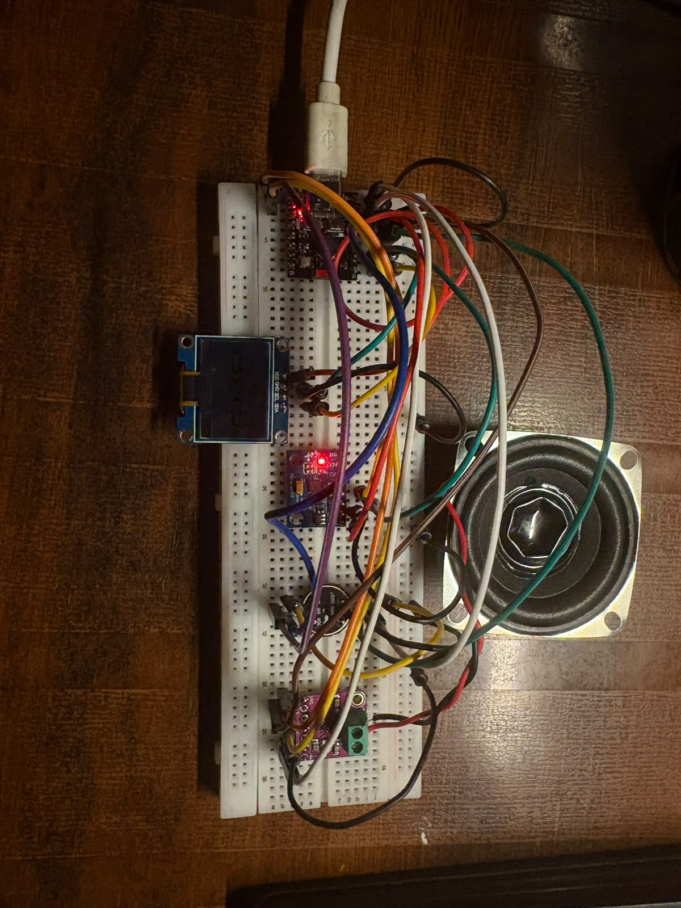

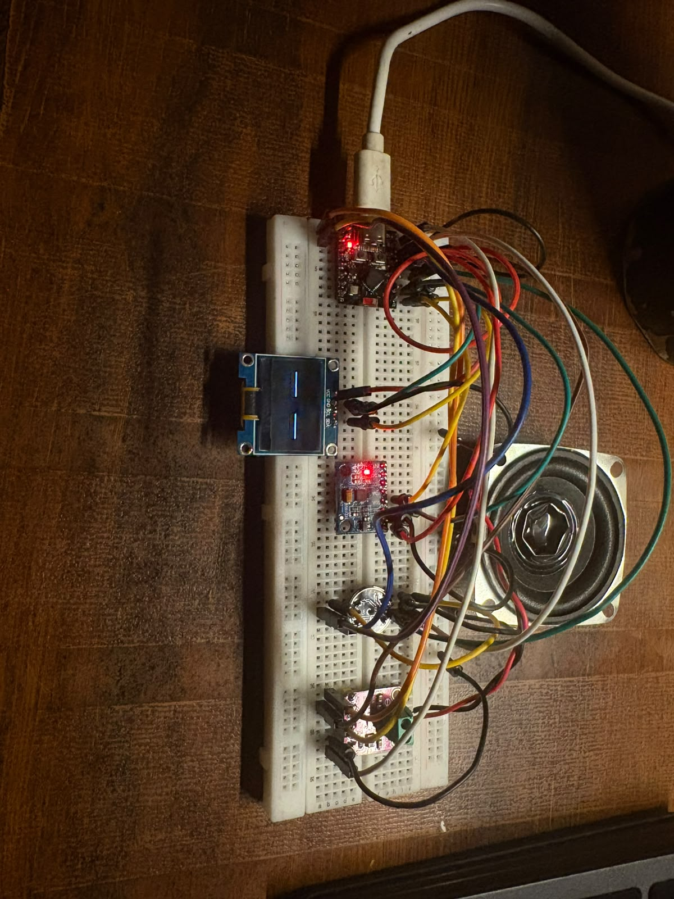

### Early Hardware Exploration

Initial component exploration during the development of DeskBot. Some components shown here were part of earlier experiments and are not included in the current hardware configuration.

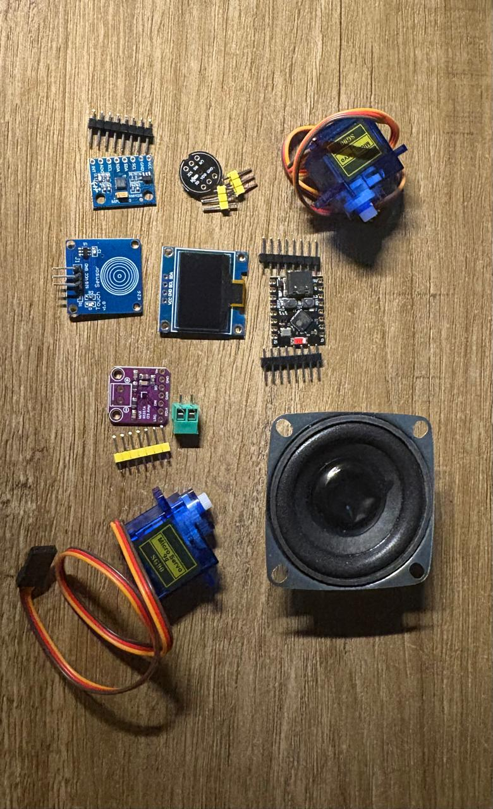

---

## Features

### 1. Interactive OLED Companion

- Animated facial expressions using a 0.96-inch SSD1306 OLED.
- Sound-triggered reactions.
- Clap detection and double-clap interaction.
- Motion-responsive behaviour using the MPU6050.
- Inactivity-based sleepy state and wake-up responses.

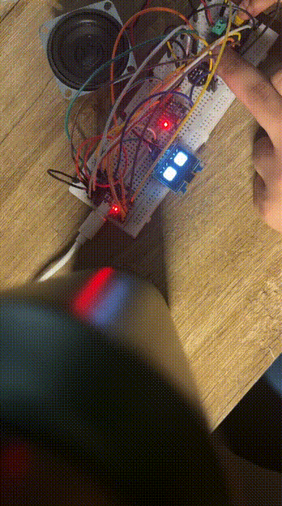

### 2. Real-Time Audio Spectrum Analyzer

- Live audio acquisition through the INMP441 microphone.
- Custom radix-2 Cooley-Tukey FFT implementation.
- Mean removal and Hann windowing.
- 16-band frequency visualisation.
- Dynamic spectrum bars and peak-hold indicators.

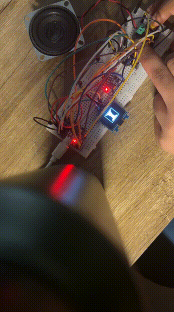

### 3. Optical Illusion Engine

Three monochrome visual experiments:

- **Rubin's Vase:** Figure-ground perception illusion.
- **Hypnotic Tunnel:** Animated concentric-circle visualisation.
- **Hermann Grid:** Grid-based optical illusion.

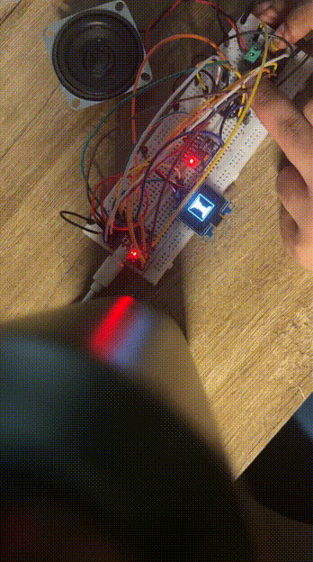

### 4. Tilt-Controlled Physics Simulator

- 40-particle simulation.
- MPU6050-based tilt interaction.
- Velocity-based particle movement.
- Boundary and particle collision handling.
- Damping and particle-scattering interaction.

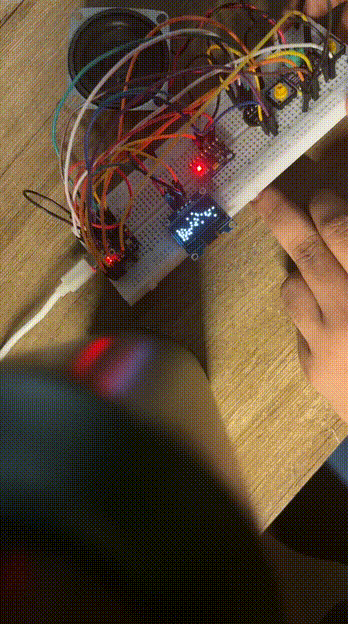

### 5. Voice Mimic

Two independent implementations exploring audio recording and playback:

| Implementation | Recording Duration | PCM Format | Sampling Rate |
|---|---:|---|---:|
| 5-second version | 5 seconds | 16-bit mono | 16 kHz |
| 10-second version | 10 seconds | 8-bit mono | 16 kHz |

Both implementations use the INMP441 microphone and MAX98357A audio amplifier.

---

## Hardware

The ESP32-C3 Super Mini acts as the central controller.

| Component | Function |
|---|---|
| ESP32-C3 Super Mini | Main controller |
| SSD1306 OLED, 128×64 | Visual output and animations |
| MPU6050 | Accelerometer and gyroscope |
| INMP441 | Digital MEMS microphone |
| MAX98357A | I2S audio amplifier |
| 4Ω speaker | Audio output |
| 2 × Push Buttons | Physical user interaction |

### Communication Interfaces

| Interface | Connected Hardware | Purpose |
|---|---|---|
| I2C | OLED, MPU6050 | Display and sensor communication |
| I2S | INMP441, MAX98357A | Digital audio input and output |
| GPIO | Push buttons | User input |

### Power

The working breadboard prototype uses a USB power bank connected to the ESP32-C3 through USB-C.

The hardware design uses 5V and 3.3V power rails with a common ground reference.

---

## System Architecture

The ESP32-C3 coordinates the different hardware peripherals and application functions.

```text
                    ESP32-C3
                        |
        +---------------+---------------+
        |               |               |
       I2C             I2S             GPIO
        |               |               |
   +----+----+     +----+----+      Push Buttons
   |         |     |         |
  OLED    MPU6050 INMP441  MAX98357A
                              |
                           Speaker
```

### Operating Modes

DeskBot combines four primary operating modes:

1. **Interactive Companion** — Animated expressions and sound/motion-based reactions.
2. **Audio Spectrum Analyzer** — Real-time frequency-domain visualisation.
3. **Optical Illusion Engine** — Three monochrome visual experiments.
4. **Physics Simulator** — Tilt-controlled particle simulation.

The integrated firmware also includes voice-mimic functionality.

For a detailed explanation, see [System Architecture](documentation/system-architecture.md).

---

## Custom PCB Design

A dedicated two-layer PCB was designed using KiCad to consolidate the hardware connections.

### Circuit Schematic

The complete circuit schematic illustrates the electrical connections between the ESP32-C3 and the connected peripherals.

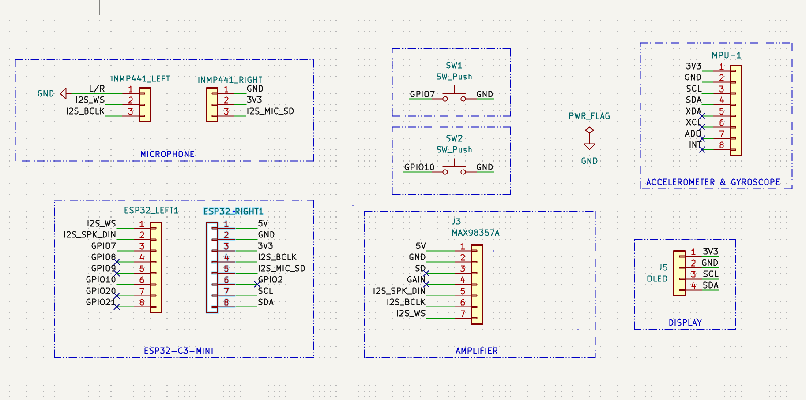

### PCB Layout

The following views show the top and bottom PCB layouts.

| Top Layer | Bottom Layer |
|:---:|:---:|
| 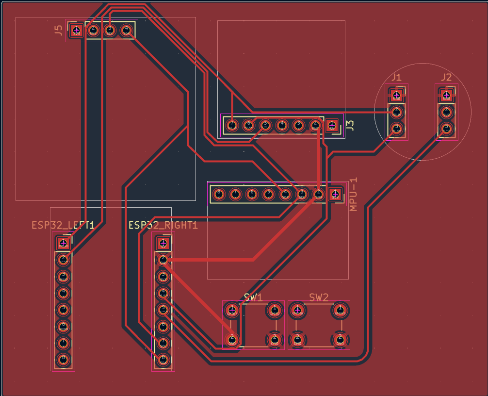 | 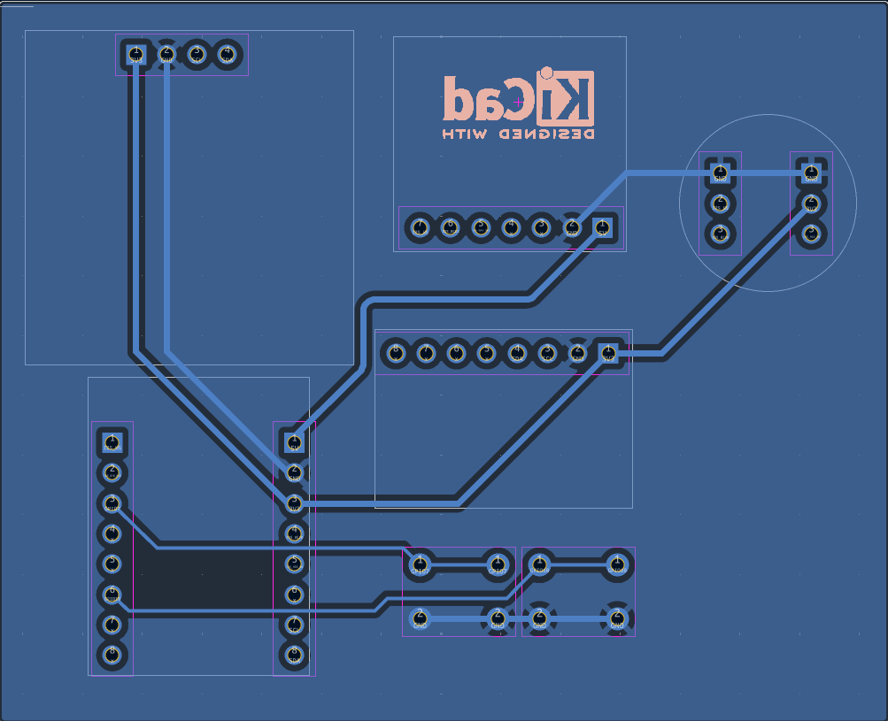 |

### 3D PCB Model

3D renders provide a visual representation of the board and its component arrangement.

| Front View | Back View | Side View |
|:---:|:---:|:---:|
| 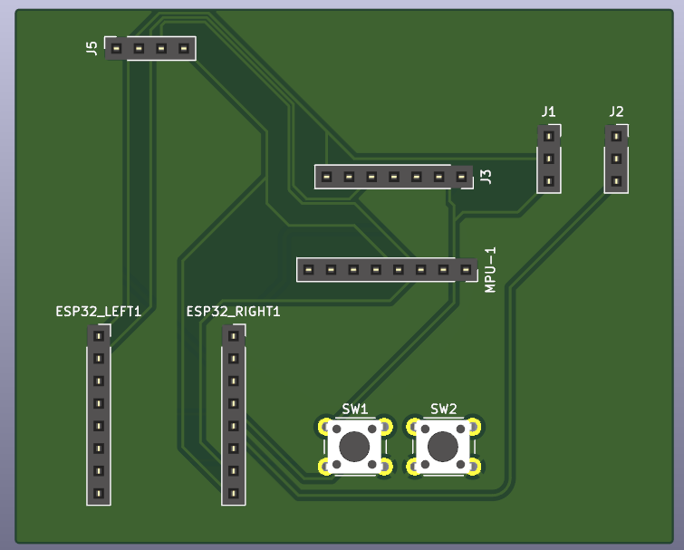 | 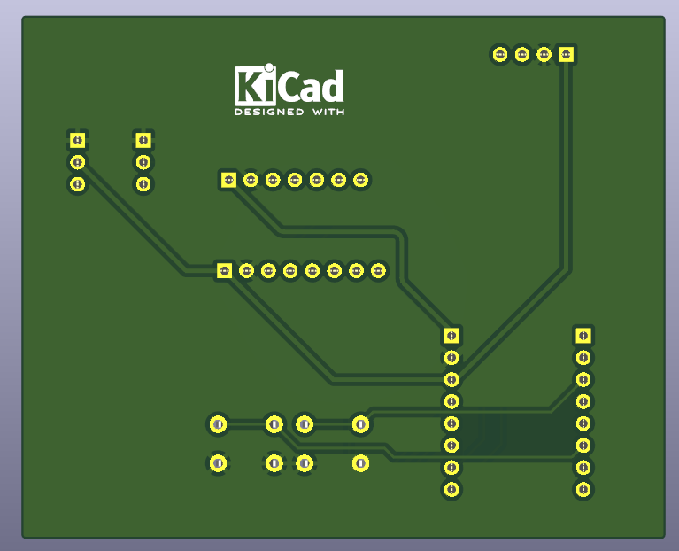 | 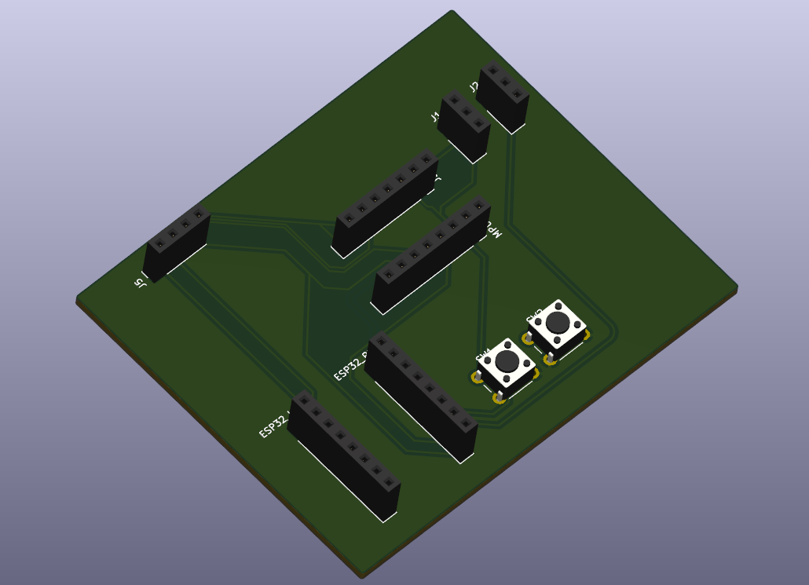 |

### PCB Specifications

| Parameter | Specification |
|---|---|
| Design software | KiCad 10 |
| Board dimensions | 74.55 × 60.55 mm |
| Copper layers | 2 |
| Board thickness | 1.6 mm |
| Substrate | FR4 |
| Grounding | GND copper zones on both layers |

The PCB provides dedicated connections for the ESP32-C3, OLED, microphone, amplifier, MPU6050 and push buttons.

### Design Verification

The initial KiCad Design Rule Check reported:

- 0 PCB violations.
- 0 unconnected items.
- 1 extra-footprint schematic-parity warning associated with the PCB logo.
- 5 ignored tests.

The PCB design and manufacturing files have been prepared. Physical fabrication, assembly and validation remain pending.

**PCB Resources:**

- [Editable KiCad Project](hardware/pcb/kicad/)
- [Gerber Manufacturing Files](hardware/pcb/gerbers/)
- [PCB Documentation](hardware/pcb/README.md)
- [Detailed PCB Design Notes](documentation/pcb-design.md)

---

## Repository Structure

```text
DeskBot/
│
├── README.md
│
├── assets/
│   └── images/
│       ├── prototype/
│       │   ├── deskbot-prototype.jpg
│       │   └── deskbot-prototype2.jpg
│       │
│       ├── features/
│       │   ├── audio-spectrum.gif
│       │   ├── audio-spectrum.jpg
│       │   ├── companion-display.gif
│       │   ├── companion-display.jpg
│       │   ├── particle-simulator.gif
│       │   ├── particle-simulator.jpg
│       │   ├── visual-experiment.gif
│       │   └── visual-experiment.jpg
│       │
│       ├── pcb/
│       │   ├── schematic.png
│       │   ├── pcb-top.png
│       │   ├── pcb-bottom.png
│       │   ├── pcb-3d-front.png
│       │   └── pcb-3d-back.png
│       │   └── pcb-3d-tilted.png
│       │
│       └── early-hardware-components.jpeg
│
├── documentation/
│   ├── design.md
│   ├── notes.md
│   ├── pcb-design.md
│   ├── progress.md
│   └── system-architecture.md
│
├── hardware/
│   ├── components.md
│   ├── pinout.md
│   ├── wiring.md
│   │
│   └── pcb/
│       ├── README.md
│       ├── gerbers/
│       └── kicad/
│           ├── pilot.kicad_pcb
│           ├── pilot.kicad_pro
│           └── pilot.kicad_sch
│
└── src/
    ├── main/
    │   └── bot/
    │       ├── eyes/
    │       ├── mimic/
    │       │   ├── 5secs/
    │       │   └── 10secs/
    │       └── proto/
    │
    └── tests/
        ├── audio/
        │   ├── MAX98/
        │   └── mic/
        │
        ├── display/
        │   └── OLED/
        │
        └── sensors/
            └── mpu6050/
```

### Directory Guide

| Directory | Purpose |
|---|---|
| `assets/images/` | Prototype photographs, feature demonstrations and PCB previews |
| `documentation/` | Design decisions, engineering notes, architecture and progress |
| `hardware/` | Component inventory, pinout, wiring and PCB resources |
| `hardware/pcb/kicad/` | Editable KiCad project files |
| `hardware/pcb/gerbers/` | PCB manufacturing outputs |
| `src/main/bot/` | Main firmware and integrated prototype |
| `src/main/bot/mimic/` | Independent voice-mimic implementations |
| `src/tests/` | Standalone hardware experiments and peripheral tests |

---

## Getting Started

### Requirements

- Arduino IDE or compatible development environment.
- ESP32 board support package.
- ESP32-C3 Super Mini.
- USB-C data cable.
- Required peripheral libraries used by the firmware.

### Running the Firmware

1. Clone or download the repository.
2. Install the ESP32 board support package.
3. Connect the ESP32-C3 using a USB-C data cable.
4. Select the appropriate ESP32-C3 board configuration and serial port.
5. Open the desired `.ino` file from the source directory.
6. Install any required libraries referenced by that sketch.
7. Compile and upload the firmware.

### Main Firmware

The integrated prototype is located at:

`src/main/bot/proto/proto.ino`

### Voice Mimic Implementations

The independent implementations are located at:

- `src/main/bot/mimic/5secs/5secs.ino`
- `src/main/bot/mimic/10secs/10secs.ino`

The standalone test sketches can be found under `src/tests/`.

**Note:** The integrated prototype and individual test sketches are separate firmware programs. Upload the sketch corresponding to the functionality you want to test.

---

## Documentation

| Document | Description |
|---|---|
| [design.md](documentation/design.md) | Design philosophy, objectives and engineering decisions |
| [notes.md](documentation/notes.md) | Technical concepts and development learnings |
| [progress.md](documentation/progress.md) | Development milestones and project status |
| [system-architecture.md](documentation/system-architecture.md) | Firmware architecture and operating modes |
| [pcb-design.md](documentation/pcb-design.md) | Custom PCB design and verification |
| [components.md](hardware/components.md) | Hardware component inventory |
| [pinout.md](hardware/pinout.md) | ESP32-C3 and peripheral pin assignments |
| [wiring.md](hardware/wiring.md) | Electrical connections and communication interfaces |

---

## Development Status

| Subsystem | Status |
|---|---|
| OLED companion | Implemented and prototype-tested |
| Audio spectrum analyser | Implemented |
| Optical illusion engine | Implemented |
| Physics simulator | Implemented |
| Voice mimic | Two independent implementations |
| Integrated firmware | Working prototype |
| Custom PCB | Designed |
| PCB fabrication | Pending |
| PCB assembly and validation | Pending |

---

## Engineering Areas Explored

DeskBot provides practical experience in:

- Embedded C/C++ programming.
- ESP32-C3 development.
- I2C and I2S communication.
- Digital audio acquisition and playback.
- Digital signal processing and FFT.
- Sensor integration and motion detection.
- Real-time graphics and OLED animation.
- Mathematical physics simulation.
- Memory management in resource-constrained systems.
- PCB schematic capture and layout using KiCad.

---

## Project Goal

The objective of DeskBot is to develop a compact interactive embedded companion that brings together audio processing, motion sensing, visualisation and expressive behaviour.

The project demonstrates how independently developed hardware and software subsystems can be integrated into a unified embedded platform.

**DeskBot is an ongoing engineering project**, with further work focused on PCB fabrication, physical assembly, system validation and firmware improvements.